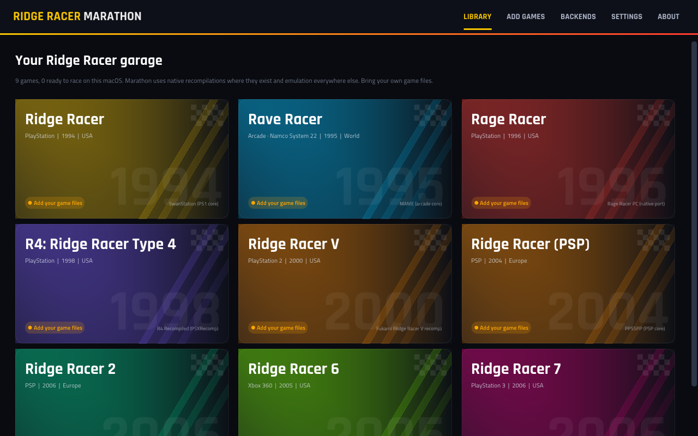

# RIDGE RACER MARATHON

One app for the whole Ridge Racer series, on macOS, Windows and Linux, with Android
and iOS to follow. Marathon recognises **your own** game dumps, picks the best way to
run each game on your device, and applies one set of enhancement settings to all of
them.

**Status:** version 0.2.2, an early release. macOS on Apple Silicon is the most
tested; the Windows and Linux packages are built and checked by CI, but Marathon has
not been played on Windows or Linux yet; Android and iOS are not buildable yet. See
[Known limitations](#known-limitations).

## Download

Get the newest package for your system from the
[releases page](https://github.com/channelramble/RIDGE-RACER-MARATHON/releases/latest):

- **macOS** (Apple Silicon, macOS 11 or newer): `RidgeRacerMarathon-macos-arm64.zip`.
  Unzip it and move *Ridge Racer Marathon* to Applications. The app is not notarized:
  on the first start macOS refuses it once; open *System Settings > Privacy & Security*
  and choose *Open Anyway*.
- **Windows** (64-bit, OpenGL 3.3): `RidgeRacerMarathon-windows-x64.zip`. Unzip it
  anywhere and run `RidgeRacerMarathon.exe`. The exe is not signed, so SmartScreen may
  warn: choose *More info > Run anyway*.
- **Linux** (x86-64, glibc 2.35 or newer, X11 or Wayland, OpenGL 3.3):
  `RidgeRacerMarathon-linux-x64.tar.gz`. Extract it and run
  `RidgeRacerMarathon/bin/RidgeRacerMarathon`.

These are **Complete packages**: the redistributable emulator and native backends are included
and set up automatically on first launch, without downloading them again. Extract
the whole archive and wait for the setup progress to finish, then add your games.
Existing backend installs and saves are preserved.

RR6's native recomp and Fukami are included on all three desktop platforms. The R4
setup kit is included on macOS and Windows; its first run still compiles from your
disc. Rave Racer native is included on all three desktop platforms. No separate RR6 install or
manual linking is needed. Source-only builds and projects without redistribution
licenses remain available through **Backends > Install all** or **Link existing**.
Game files, BIOS and firmware are not included. See the exact
[bundle contents and exclusions](docs/BUNDLED_BACKENDS.md); the matching backend
source archives are on the same release page, but are not needed to play.
Bring your own game files (see [What you need](#what-you-need)).

The enhancement settings:

- **High resolution:** internal rendering up to 4K/8K where the backend supports it.
- **Ultrawide:** 21:9, 32:9 or your screen's own shape. Native on Ridge Racer (redraw),
  R4, Rave Racer and Ridge Racer 6; a widened view (2D HUD stretched) on the other PS1
  games, the European discs of the PSP games and Ridge Racer 7 (Marathon's own patch for
  the USA disc); 21:9 on Ridge Racer V (wider through an experimental PCSX2 patch).
  Details per game: [docs/SETTINGS.md](docs/SETTINGS.md).
- **Controllers:** one set of controller settings for every game (analog stick or d-pad
  steering, trigger pedals, vibration, dead zone, players), and a whole UI that works with
  a gamepad ([docs/CONTROLLERS.md](docs/CONTROLLERS.md)).
- **High refresh rate:** up to 360 FPS (Rage Racer PC up to 1000): real frames from
  the native redraws and the recomps that support it, motion-interpolated in-between
  images for games running inside Marathon and, on macOS, for Ridge Racer 6 and 7
  (frame generation); display-rate presentation everywhere else.
- **Game speed-up:** base speed and hold-to-fast-forward.
- **Experimental redraws:** native re-rendering of the 3D scene for the old
  titles (Ridge Racer's native-scene renderer, Rage Racer's modern renderer,
  Rave Racer's native port).

When a public **recompilation or native port** exists, Marathon uses it. Every
other game runs through an emulator. Marathon contains no game data and never
downloads any.

## Supported games and how they run

| Game | macOS (Apple Silicon) | Windows x64 | Linux x64 | Android | iOS |
|---|---|---|---|---|---|
| Ridge Racer (PS1, 1994) | **RR1 Recomp** (your local build) - SwanStation | SwanStation (RR1 Recomp experimental) | SwanStation | SwanStation / PCSX-ReARMed | SwanStation / PCSX-ReARMed |
| Rave Racer (Arcade, 1995) | **namco22 native port** - MAME core | **namco22 native port** - MAME core | **namco22 native port** - MAME core | MAME core | MAME core |
| Rage Racer (PS1, 1996) | **Rage Racer PC** | **Rage Racer PC** | **Rage Racer PC** | SwanStation / PCSX-ReARMed | SwanStation / PCSX-ReARMed |
| R4 (PS1, 1998) | **R4 Recomp** | **R4 Recomp** | **R4 Recomp** (AppImage) | SwanStation / PCSX-ReARMed | SwanStation / PCSX-ReARMed |
| Ridge Racer V (PS2, 2000) | **Fukami recomp** (macOS 27+) - PCSX2 | **Fukami recomp** - PCSX2 | **Fukami recomp** - PCSX2 | ARMSX2 / NetherSX2 app | - (needs JIT) |
| Ridge Racer (PSP, 2004) | PPSSPP core | PPSSPP core | PPSSPP core | PPSSPP core | PPSSPP core |
| Ridge Racer 2 (PSP, 2006) | PPSSPP core | PPSSPP core | PPSSPP core | PPSSPP core | PPSSPP core |
| Ridge Racer 6 (Xbox 360, 2005) | **RR6 Recompiled** (your local build) | **RR6 Recompiled** - Xenia Canary | **RR6 Recompiled** (test) - Xenia Canary | - | - |
| Ridge Racer 7 (PS3, 2006) | RPCS3 | RPCS3 | RPCS3 | aPS3e app | - |

**Bold** = native recompilation or source port. "Core" = libretro core running
inside Marathon. Mobile platforms can't launch other programs, so games run
inside Marathon via cores, or (Android) are handed to an installed emulator app.
The Android and iOS packages are not buildable yet ([docs/BUILDING.md](docs/BUILDING.md)).

## What you need

- Your own dumps: CUE/BIN or CHD (PS1; R4 as CUE/BIN only), CUE/BIN, ISO or CHD
  (PS2), ISO, CSO or CHD (PSP), a decrypted ISO or PS3_GAME folder (PS3), an ISO or
  extracted game folder (Xbox 360) and the MAME `raverace` romset including the
  `c71.bin` / `c74.bin` MCU ROMs (older `raveracw` sets work; Marathon rebuilds
  the sets by CRC).
- PS2 BIOS (only for PCSX2 and the Android PS2 apps; Fukami needs none) and the
  official PS3 system software `PS3UPDAT.PUP` (for RPCS3). The PS1 cores run without
  a BIOS (SwanStation's built-in OpenBIOS, PCSX-ReARMed's HLE BIOS).
- R4 Recomp's first launch on macOS and Windows compiles the game from your disc
  (10-20 minutes, its own wizard). Ridge Racer's recomp is source-only upstream; link
  a local build.

## Using it

1. **Add games:** drop files/folders on the window, or *Add games > Scan a folder*.
   Marathon identifies dumps by their contents (boot serial, PARAM.SFO, XEX title
   ID, ROM CRCs) and can verify them against known-good hashes.
2. **Pick a game:** the game page shows how it will run, lets you install or link
   the backend, and holds the enhancement settings.
3. **Race:** in-app games: Esc / Guide / MENU opens the pause menu, Tab or
   right-stick click fast-forwards, F11 toggles fullscreen, F5/F8 save/load state.
4. **Controllers** work out of the box, both in Marathon's menus and in every game;
   hold Guide + Start to close any game. See [docs/CONTROLLERS.md](docs/CONTROLLERS.md).

## Known limitations

- **Frame generation** (macOS, Ridge Racer 6 and 7) has only been run on a 60 Hz
  display in a forced test mode, not yet on a real 120-360 Hz display.
- **Interpolation quality depends on the content:** fast camera swings can look worse
  than a plain blend (for games inside Marathon, set *Smoothing method* to
  *Frame blend*).
- **Ridge Racer V:** frame generation is not possible for Fukami, which starts the game
  with a fresh environment of its own; it stays at the game's 60 fps.
- **Ridge Racer 7 ultrawide** has been checked on captured frames, not on a real
  ultrawide monitor. It needs fullscreen on a screen wider than 16:9 and stretches the
  2D HUD.
- **Ridge Racer 6 recompilation on macOS**: the bundled Apple Silicon build reached
  56.6–60 fps in short 720p race samples on an M4 Pro. Shader-compilation stalls
  remain; slower Macs can run below full speed. Requires macOS 14 or newer.
- **macOS package:** ad-hoc signed unless built with a Developer ID, so Gatekeeper asks
  for confirmation on the first start (System Settings > Privacy & Security > Open Anyway).
- **Controllers** ([details](docs/CONTROLLERS.md)): the Ridge Racer recompilation reads the
  controller as a digital pad only (the game rejects analog); Ridge Racer 6 on Xenia needs a
  trigger layout picked once in the game's own options for analog gas and brake; in Fukami
  the triggers are the PS2's L2 / R2, not the pedals; on macOS the Guide button may be taken
  by the system (use Back + Start to close games then). Controller support was tested with
  virtual controllers, not yet with every real one.

## Building

See [docs/BUILDING.md](docs/BUILDING.md). Architecture notes:
[docs/ARCHITECTURE.md](docs/ARCHITECTURE.md). Settings mapping per backend:
[docs/SETTINGS.md](docs/SETTINGS.md) and [docs/RECOMPS.md](docs/RECOMPS.md). Your own
catalog entries: [docs/CATALOG.md](docs/CATALOG.md). Contributing and reporting
problems: [CONTRIBUTING.md](CONTRIBUTING.md).

## Legal

Marathon is an unofficial fan project, MIT licensed (see [LICENSE](LICENSE)).
Ridge Racer and related titles are trademarks of Bandai Namco Entertainment.
Backends keep their own licences ([THIRD_PARTY_NOTICES.md](THIRD_PARTY_NOTICES.md));
those without a redistribution licence are only downloaded by your machine
from their official release pages.
